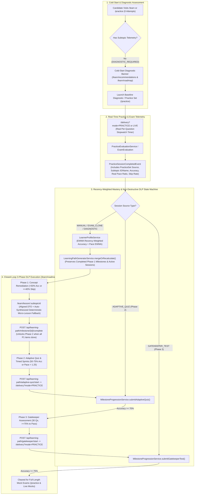

# Adaptive Learning Flow Audit, Gap Analysis & Refined Architecture

## 1. Executive Summary

Following the completion of Epic [#346](https://github.com/natassgrid/nag/issues/346) (*Automated Adaptive Learning Engine & Dynamic Learning Path Platform*), we performed a full-stack code and runtime contract audit across the Candidate Delivery portal (`http://localhost:4300`) and backing microservices (`practice-service`, `recommendation-service`, `question-bank-service`, `delivery-service`):

- **Practice Hub**: `http://localhost:4300/practice` ([`PracticeHubComponent`](file:///home/sheel/IdeaProjects/nag/nag-frontend-workspace/apps/candidate-delivery/src/app/practice/practice-hub.component.ts))
- **AI Insights & Study Plan**: `http://localhost:4300/learn/recommendations` ([`RecommendationsDashboardComponent`](file:///home/sheel/IdeaProjects/nag/nag-frontend-workspace/apps/candidate-delivery/src/app/learn/components/recommendations-dashboard/recommendations-dashboard.component.ts))
- **Dynamic Learning Path (DLP) Roadmap**: `http://localhost:4300/learn/roadmap` ([`DlpRoadmapComponent`](file:///home/sheel/IdeaProjects/nag/nag-frontend-workspace/apps/candidate-delivery/src/app/learn/components/dlp-roadmap/dlp-roadmap.component.ts))
- **Remedial Micro-Lesson Reader**: `http://localhost:4300/learn/lesson/:subtopicId` ([`MicroLessonViewerComponent`](file:///home/sheel/IdeaProjects/nag/nag-frontend-workspace/apps/candidate-delivery/src/app/learn/components/micro-lesson-viewer/micro-lesson-viewer.component.ts))

While the individual backend engines and Angular 22 UI components exist, **12 critical integration gaps, DTO contract mismatches, and state-machine bugs** currently prevent the end-to-end adaptive learning loop from functioning as a closed-loop system.

---

## 2. Detailed Gap & Root-Cause Catalog

### Category A: Breaking Frontend $\leftrightarrow$ Backend DTO Contract Mismatches

| ID | Gap / Issue | Frontend File & Expectancy | Backend File & Actual Payload | User-Visible Impact |
|---|---|---|---|---|
| **A1** | **Micro-Lesson Viewer Renders Blank Body** | [`micro-lesson-viewer.component.html`](file:///home/sheel/IdeaProjects/nag/nag-frontend-workspace/apps/candidate-delivery/src/app/learn/components/micro-lesson-viewer/micro-lesson-viewer.component.html#L59-L200) & [`micro-lesson.model.ts`](file:///home/sheel/IdeaProjects/nag/nag-frontend-workspace/apps/candidate-delivery/src/app/learn/models/micro-lesson.model.ts#L36-L59) expect a nested `ml.content` object with `coreConcept`, `trapAlert: { title, description, ... }`, `formulaCheatSheet: FormulaEntry[]`, `stepByStepBreakdown: StepItem[]`, `keyTakeaways`, and `quickCheckItems`. | [`MicroLessonResponse.java`](file:///home/sheel/IdeaProjects/nag/backend/question-bank-service/src/main/java/com/examplatform/questionbank/microlesson/dto/MicroLessonResponse.java#L13-L59) returns flat top-level fields: `coreConcept: String`, `trap: String`, `cheatSheet: List<String>`, `stepByStepBreakdown: { questionStem, steps, finalAnswer }` with **no `content` wrapper**. | When opening `/learn/lesson/:subtopicId`, `ml.content` is `undefined`, so all 6 content cards are skipped and the lesson page renders blank. |
| **A2** | **Phase 1 Milestone Completion Is Broken** | [`dlp-roadmap.component.html`](file:///home/sheel/IdeaProjects/nag/nag-frontend-workspace/apps/candidate-delivery/src/app/learn/components/dlp-roadmap/dlp-roadmap.component.html#L117-L155) & [`dlp-roadmap.component.ts`](file:///home/sheel/IdeaProjects/nag/nag-frontend-workspace/apps/candidate-delivery/src/app/learn/components/dlp-roadmap/dlp-roadmap.component.ts#L70) read `item.milestoneId` and `item.status === 'COMPLETED'`. | [`MilestoneItemDto.java`](file:///home/sheel/IdeaProjects/nag/backend/recommendation-service/src/main/java/com/examplatform/recommendation/dto/MilestoneItemDto.java#L12-L26) serializes `id: String` (e.g., `"P1-1"`) and `completed: boolean`. | Clicking **"Study Lesson"** passes `milestoneId=undefined`; clicking **"Mark as Studied & Continue"** in [`MicroLessonViewerComponent`](file:///home/sheel/IdeaProjects/nag/nag-frontend-workspace/apps/candidate-delivery/src/app/learn/components/micro-lesson-viewer/micro-lesson-viewer.component.ts#L135-L140) exits early without calling `POST /api/learning-path/milestone/{id}/complete`. Phase 1 progress stays stuck at `0%`. |
| **A3** | **Phase 2 & Phase 3 Permanently Locked in UI** | [`dlp-roadmap.component.ts`](file:///home/sheel/IdeaProjects/nag/nag-frontend-workspace/apps/candidate-delivery/src/app/learn/components/dlp-roadmap/dlp-roadmap.component.ts#L54-L57) parses `Number(milestoneGraph.currentPhase) \|\| 1`. | [`LearningPathGeneratorService.java`](file:///home/sheel/IdeaProjects/nag/backend/recommendation-service/src/main/java/com/examplatform/recommendation/service/LearningPathGeneratorService.java#L71-L80) sets `currentPhase` to `"PHASE_1_REMEDIATION"`, `"PHASE_2_ADAPTIVE_QUIZ"`, `"PHASE_3_GATEKEEPER"`, or `"COMPLETED"`. | `Number("PHASE_2_ADAPTIVE_QUIZ")` is `NaN`, falling back to `1`. `currentPhaseNumber()` is always `1`, keeping Phase 2 and Phase 3 visually locked even when unlocked on the backend. |
| **A4** | **DLP Top-Level Property Mismatches** | [`learning-path.model.ts`](file:///home/sheel/IdeaProjects/nag/nag-frontend-workspace/apps/candidate-delivery/src/app/learn/models/learning-path.model.ts#L34-L45) reads `lp.targetExam` and `lp.gatekeeperPassed` at top level. | [`DynamicLearningPathResponse.java`](file:///home/sheel/IdeaProjects/nag/backend/recommendation-service/src/main/java/com/examplatform/recommendation/dto/DynamicLearningPathResponse.java#L14-L23) serializes `examTarget` at top level and `gatekeeperPassed` inside `milestoneGraph`. | Target exam badge and Gatekeeper status badge on `/learn/recommendations` and `/learn/roadmap` fail to bind accurately. |
| **A5** | **Gatekeeper Modal Missing Gap Lists** | [`gatekeeper-dialog.component.ts`](file:///home/sheel/IdeaProjects/nag/nag-frontend-workspace/apps/candidate-delivery/src/app/learn/components/gatekeeper-dialog/gatekeeper-dialog.component.ts#L34-L40) reads `status.conceptualGaps` and `status.applicationGaps`. | [`GatekeeperStatusResponse.java`](file:///home/sheel/IdeaProjects/nag/backend/recommendation-service/src/main/java/com/examplatform/recommendation/dto/GatekeeperStatusResponse.java#L8-L15) only returns `remedialSubtopics` (Phase 1 only). | Application gaps are never displayed in the Gatekeeper intercept modal. |

---

### Category B: Broken State-Machine Transitions & Feedback Loops

> [!CAUTION]
> **Destructive DLP Overwrite on Every Practice Submission**:
> In [`PracticeSessionCompletedConsumer.java`](file:///home/sheel/IdeaProjects/nag/backend/recommendation-service/src/main/java/com/examplatform/recommendation/event/PracticeSessionCompletedConsumer.java#L21-L30), every completed practice session unconditionally calls `learningPathGeneratorService.generateOrRecalculate()`, which marks the active `DynamicLearningPath` as `SUPERSEDED` and creates a brand-new DLP with all Phase 1 milestones reset to `completed: false`!

1. **B1 — Phase 2 Adaptive Quiz & Phase 3 Gatekeeper Submissions Never Advance the DLP State Machine**:
   - Launching a Phase 2 Adaptive Quiz or Phase 3 Gatekeeper Test creates a `PracticeSet` (`source = 'ADAPTIVE_QUIZ'` or `'GATEKEEPER_TEST'`) and routes the user to `/practice?setId=<setId>`.
   - When the candidate finishes the quiz in `/delivery?mode=PRACTICE`, `POST /api/practice/sessions/{id}/submit` fires `PracticeSessionCompletedEvent`, which **never calls** `MilestoneProgressionService.submitAdaptiveQuiz()` or `submitGatekeeperTest()`.
   - Because real quiz submissions never advance Phase 2 or Phase 3, hardcoded demo buttons (`"Submit 80% (Pass)"` and `"Submit 85% (Pass)"`) were left in [`dlp-roadmap.component.html`](file:///home/sheel/IdeaProjects/nag/nag-frontend-workspace/apps/candidate-delivery/src/app/learn/components/dlp-roadmap/dlp-roadmap.component.html#L244-L356).

2. **B2 — Cold-Start Candidates Are Marked "100% Mastered / Gatekeeper Cleared"**:
   - When a brand-new candidate (`0` practice sessions) visits `/learn/recommendations` or `/learn/roadmap`, `GET /api/learning-path/current` auto-triggers `generateOrRecalculate()`.
   - Because `learner_subtopic_performance` is empty, `conceptualGaps` and `applicationGaps` are both empty, and [`LearningPathGeneratorService.java`](file:///home/sheel/IdeaProjects/nag/backend/recommendation-service/src/main/java/com/examplatform/recommendation/service/LearningPathGeneratorService.java#L78-L91) immediately sets `currentPhase = "COMPLETED"` and `gatekeeperPassed = true`!
   - As a result, a new user with zero attempts sees **100% Overall Progress ("Mastered ✓")** and the Cold-Start Onboarding Banner in [`recommendations-dashboard.component.html`](file:///home/sheel/IdeaProjects/nag/nag-frontend-workspace/apps/candidate-delivery/src/app/learn/components/recommendations-dashboard/recommendations-dashboard.component.html#L137) is dead code.

3. **B3 — Personal Adaptive & Gatekeeper Sets Pollute Global `/practice` Catalog**:
   - [`AdaptiveQuizGenerator.java`](file:///home/sheel/IdeaProjects/nag/backend/practice-service/src/main/java/com/examplatform/practice/service/AdaptiveQuizGenerator.java#L145) marks every candidate's generated `ADAPTIVE_QUIZ` and `GATEKEEPER_TEST` set as `published = true`, and [`PracticeSetService.getPublishedSets()`](file:///home/sheel/IdeaProjects/nag/backend/practice-service/src/main/java/com/examplatform/practice/service/PracticeSetService.java#L21-L25) returns all `published = true` sets globally to every candidate on `/practice`.

4. **B4 — Missing `subtopicId` Resolution & 404 on Unseeded Micro-Lessons**:
   - Questions without a foreign-key `subtopic_id` produce `MilestoneItemDto` entries with `subtopicId: null`, making **"Study Lesson"** a silent no-op in [`dlp-roadmap.component.ts`](file:///home/sheel/IdeaProjects/nag/nag-frontend-workspace/apps/candidate-delivery/src/app/learn/components/dlp-roadmap/dlp-roadmap.component.ts#L121-L126).
   - Even when `subtopicId` is non-null, `GET /api/micro-lessons/subtopic/{subtopicId}` throws `404 Not Found` unless an admin has manually pre-generated and published a micro-lesson for that subtopic. It should auto-synthesize or serve the deterministic lesson on demand when none is published yet.

---

### Category C: Telemetry, Gatekeeper Enforcement & Mastery Algorithm Gaps

1. **C1 — Gatekeeper Check Bypassed in Frontend & Backend**:
   - In [`PracticeSessionService.java`](file:///home/sheel/IdeaProjects/nag/backend/practice-service/src/main/java/com/examplatform/practice/service/PracticeSessionService.java#L87-L92), backend Gatekeeper validation checks `if ("FULL_MOCK".equalsIgnoreCase(practiceSet.getSource()))`, which never matches any valid source (`EXAM_CLONE`, `MANUAL`, etc.).
2. **C2 — Hardcoded `timeSpentMs: 15000` in Practice Delivery**:
   - [`exam-delivery.service.ts`](file:///home/sheel/IdeaProjects/nag/nag-frontend-workspace/apps/candidate-delivery/src/app/exam-delivery/services/exam-delivery.service.ts#L394-L434) sends `timeSpentMs: 15000` on every response in practice mode instead of tracking actual per-question dwell time. Consequently, `paceRatio` is always `~0.17` and `TIMED_SPRINT_DRILLS` (`paceRatio > 1.25`) can never trigger.
3. **C3 — Live Exam Submissions Disconnected from Adaptive Learning**:
   - Completing a live exam (`/delivery?mode=LIVE` $\rightarrow$ `/results/:attemptId`) does not update `learner_subtopic_performance` or `DynamicLearningPath`, and `/results/:attemptId` has no CTA to `/learn/roadmap` or `/learn/recommendations`.
4. **C4 — Static Lifetime Cumulative Accuracy Prevents Mastery Graduation**:
   - [`LearnerProfileService.java`](file:///home/sheel/IdeaProjects/nag/backend/recommendation-service/src/main/java/com/examplatform/recommendation/service/LearnerProfileService.java#L223-L234) computes `rollingAccuracy` as lifetime `totalCorrect / totalAttempts * 100`. A student who scores `0/10` initially must score `30/30` consecutively just to reach `75%`, because there is no recency weighting (EWMA) or Bayesian Knowledge Tracing (BKT).
5. **C5 — Ephemeral 7-Day Study Plan & Missing Direct Subtopic Drill Links**:
   - Checked days in [`StudyPlanPanelComponent`](file:///home/sheel/IdeaProjects/nag/nag-frontend-workspace/apps/candidate-delivery/src/app/learn/components/study-plan-panel/study-plan-panel.component.ts#L15-L25) are stored only in an in-memory signal and lost on navigation/refresh. Weak-topic cards in `/learn/recommendations` only link to generic `/practice` instead of offering direct **"Study Micro-Lesson"** (`/learn/lesson/:subtopicId`) and **"Start Subtopic Drill"** actions.

---

## 3. Refined End-to-End Adaptive Learning Flow Architecture

---

## 4. Planned Epic & Child Issues Breakdown

- **Parent Epic**: `[Epic] Adaptive Learning Loop v2: Closed-Loop DLP State Machine, Contract Alignment & Recency-Weighted Mastery`
  1. **Child Issue 1 (Micro-Lesson Contract & On-Demand Fallback)**: `fix(adaptive-learning): Align MicroLessonResponse DTO contract with MicroLessonViewerComponent & enable on-demand deterministic micro-lesson fallback`
  2. **Child Issue 2 (DLP Roadmap Contract & Phase Unlocks)**: `fix(dlp-roadmap): Fix MilestoneItemDto, MilestoneGraphDto.currentPhase & DynamicLearningPathResponse contract mismatches breaking Phase 1–3 progression`
  3. **Child Issue 3 (Quiz Submission Wiring & Non-Destructive DLP Merge)**: `feat(learning-engine): Wire Phase 2 Adaptive Quiz & Phase 3 Gatekeeper session submissions into DLP state machine without destructive path resets`
  4. **Child Issue 4 (Cold-Start Diagnostic State & Catalog Isolation)**: `feat(adaptive-onboarding): Introduce DIAGNOSTIC_REQUIRED state for cold-start candidates & isolate personal adaptive/gatekeeper sets from global /practice catalog`
  5. **Child Issue 5 (Per-Question Stopwatch, Gatekeeper Enforcement & EWMA Mastery)**: `feat(telemetry-mastery): Track real per-question timeSpentMs in Practice Delivery, enforce Gatekeeper on full mocks & upgrade rollingAccuracy to EWMA mastery`
  6. **Child Issue 6 (Live Exam Telemetry Bridge & Persistent Study Plan UX)**: `feat(learn-ux): Connect Live Exam results to Adaptive Learning Engine, persist 7-Day Study Plan progress & add direct subtopic drill/lesson CTAs`
