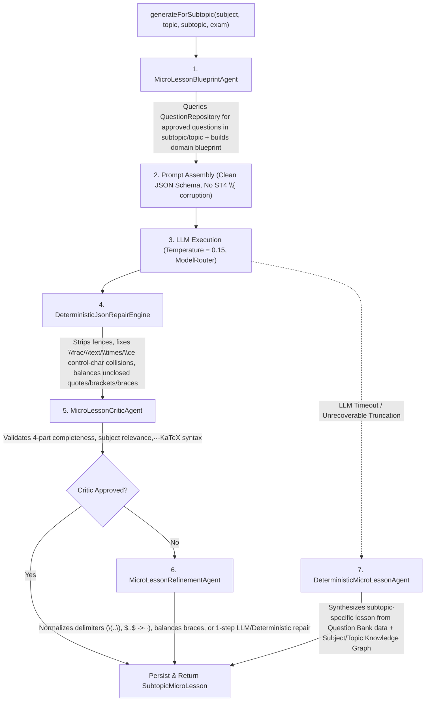

# Root Cause Analysis & Deterministic Micro-Lesson Generation Agent Design

## 1. Root Cause Analysis of Current Failures

An investigation of [`MicroLessonGeneratorService`](file:///home/sheel/IdeaProjects/nag/backend/question-bank-service/src/main/java/com/examplatform/questionbank/microlesson/ai/MicroLessonGeneratorService.java), [`MicroLessonPromptBuilder`](file:///home/sheel/IdeaProjects/nag/backend/question-bank-service/src/main/java/com/examplatform/questionbank/microlesson/ai/MicroLessonPromptBuilder.java), and the prompt templates in [`system-prompt.st`](file:///home/sheel/IdeaProjects/nag/backend/question-bank-service/src/main/resources/prompts/microlesson/system-prompt.st) and [`prompts.yaml`](file:///home/sheel/IdeaProjects/nag/backend/question-bank-service/src/main/resources/prompts/prompts.yaml) revealed **five compounding root causes** behind the logs:

> `Direct parse failed (Unexpected end-of-input: expected close marker for Object (start marker at line: 1, column: 1) at [line: 14, column: 4]), applying LaTeX JSON sanitization and retrying...`

### Root Cause 1: Truncated JSON & Unbalanced Structural Closures from Local Small Models (`qwen2.5:1.5b`)
- When generating for `IBPS-PO-PRE-2027` (`Difficulty: MEDIUM`), [`ModelRouter`](file:///home/sheel/IdeaProjects/nag/backend/question-bank-service/src/main/java/com/examplatform/questionbank/ai/generation/ModelRouter.java) selects `qwen2.5:1.5b` (when local/Ollama mode is active).
- At line 14, column 4 (right after the `"steps": [ ... ]` or `"finalAnswer"` line of `stepByStepBreakdown`), `qwen2.5:1.5b` either:
  1. Emits only **one** closing brace `}` instead of **two** (`}` for `stepByStepBreakdown` + `}` for the root JSON object), or
  2. Hits the default Ollama output token limit (`num_predict`) or stops early on a stop token, or
  3. Wraps only part of the response or appends trailing text/markdown after an unclosed object.
- Because `parseAndValidate` only runs `sanitizeLatexJson(jsonText)` (which only escapes backslashes) and never repairs **truncated or structurally unbalanced JSON** (`}` / `]` / `"` closures), the retry fails with the exact same `Unexpected end-of-input: expected close marker for Object` exception!

### Root Cause 2: Prompt Template Escaping Bug (`\{` and `\}`) Corrupting Model Output
- In [`prompts.yaml`](file:///home/sheel/IdeaProjects/nag/backend/question-bank-service/src/main/resources/prompts/prompts.yaml#L39-L52) and [`system-prompt.st`](file:///home/sheel/IdeaProjects/nag/backend/question-bank-service/src/main/resources/prompts/microlesson/system-prompt.st#L32-L45), braces in the JSON schema and LaTeX examples were escaped as `\{` and `\}` to avoid StringTemplate4 (`ST4`) parsing errors.
- However, when `PromptTemplateService.render()` fails on ST4 syntax and falls back to `fallbackRender()` ([`PromptTemplateService.java`](file:///home/sheel/IdeaProjects/nag/backend/question-bank-service/src/main/java/com/examplatform/questionbank/ai/prompt/PromptTemplateService.java#L197-L205)), `fallbackRender` returns the raw template **with literal `\{` and `\}` intact**!
- Even worse, in [`MicroLessonPromptBuilder.getSystemPrompt()`](file:///home/sheel/IdeaProjects/nag/backend/question-bank-service/src/main/java/com/examplatform/questionbank/microlesson/ai/MicroLessonPromptBuilder.java#L73-L80), `system-prompt` has **zero template variables**, yet it is passed through `promptTemplateService.render()`, sending literal `\{`, `\}`, `\frac\{1\}\{100\}`, and `\ce\{2H2 + O2 -> 2H2O\}` to the LLM! Small models (`qwen2.5:1.5b`, `llama3.2:1b`) imitate this broken syntax, emitting invalid JSON like `\{ "coreConcept": ...` or unclosed objects.

### Root Cause 3: High Temperature (`0.7`) Without Deterministic Sampling or Repair Loop
- [`MicroLessonGeneratorService`](file:///home/sheel/IdeaProjects/nag/backend/question-bank-service/src/main/java/com/examplatform/questionbank/microlesson/ai/MicroLessonGeneratorService.java#L139) uses `.temperature(0.7)` for strict schema generation. At `0.7`, 1.5B parameter models frequently drift from strict JSON grammar, omit closing braces, or invent extra keys.
- Using a deterministic temperature (`0.1` – `0.2`) and structured extraction/repair dramatically increases schema adherence.

### Root Cause 4: Flawed `sanitizeLatexJson` Regex & Missing Delimiter Normalization
- `sanitizeLatexJson` uses `(?<!\\)\\(?![\"\\/bfnrtu]|u[0-9a-fA-F]{4})`.
- Look at what happens when the LLM writes `\frac`, `\theta`, `\tau`, `\times`, `\text`, `\beta`, `\begin`, `\bf`, `\nu`, `\neq`, `\neg`, `\rightarrow`, `\rho`:
  - They start with `f`, `t`, `b`, `n`, `r`!
  - Because `[\"\\/bfnrtu]` excludes `b`, `f`, `n`, `r`, `t`, **Jackson parses `\frac` as `form-feed (\f) + "rac"`**, `\theta` / `\times` / `\text` as **`TAB (\t) + "heta"/"imes"/"ext"`**, `\beta` as **`BACKSPACE (\b) + "eta"`**, and `\neq` as **`NEWLINE (\n) + "eq"`**!
  - Furthermore, if the LLM emits `\( ... \)` or `\[ ... \]` or single `$ ... $`, `MicroLessonGeneratorService` does not normalize them to `$$ ... $$` before validation.

### Root Cause 5: Hardcoded Physics Fallback Template Across All Subjects
- When `parseAndValidate` throws an exception, `buildFallbackContent(subject, topic, subtopic, exam)` generates a **hardcoded Physics Rotational Mechanics template** (`$$\Delta K + \Delta U = W_{ext}$$`, `$$I = \int r^2 \, dm$$`, `"4.5 \times 10^3 \text{ J}"`, `"Indian bicycle chain"`) regardless of whether the subtopic is **Chemistry ("Carbon and its Compounds", "Organic")**, **Banking ("Monetary Policy")**, **Polity ("Fundamental Rights")**, **English ("Synonyms")**, or **Quantitative Aptitude ("Percentages")**!

---

## 2. Deterministic Micro-Lesson Generation Agent Architecture

We will design and implement a **Multi-Stage Deterministic Micro-Lesson Generation Agent Pipeline** in `com.examplatform.questionbank.microlesson.ai` modeled after the multi-agent architecture in `questionbank.ai.generation.multiagent`, combining:
1. **RAG Question Bank Grounding (`MicroLessonBlueprintAgent`)**
2. **Low-Temperature Prompting & Self-Healing JSON/LaTeX Parser (`DeterministicJsonRepairEngine`)**
3. **Pedagogical & KaTeX Critic + Bounded Refinement (`MicroLessonCriticAgent` & `MicroLessonRefinementAgent`)**
4. **Domain-Aware Deterministic Curriculum Synthesizer (`DeterministicMicroLessonAgent`)** — a zero-failure, domain-specific deterministic generator that synthesizes accurate, subject/topic/subtopic-specific micro-lessons grounded in existing Question Bank questions and curated domain knowledge graphs when the LLM is unavailable or fails after bounded retry.

### Component Breakdown

| Component | Responsibility |
|---|---|
| [`MicroLessonBlueprintAgent`](file:///home/sheel/IdeaProjects/nag/backend/question-bank-service/src/main/java/com/examplatform/questionbank/microlesson/ai/agent/MicroLessonBlueprintAgent.java) | Inspects `Subject`, `Topic`, `Subtopic` metadata and queries `QuestionRepository` for existing questions/explanations on the subtopic to ground the lesson in real exam questions and domain taxonomy (STEM vs. Quantitative vs. Verbal/Humanities vs. Banking/GS). |
| [`DeterministicJsonRepairEngine`](file:///home/sheel/IdeaProjects/nag/backend/question-bank-service/src/main/java/com/examplatform/questionbank/microlesson/ai/agent/DeterministicJsonRepairEngine.java) | State-machine JSON & LaTeX sanitizer: extracts JSON object from preamble/postamble, protects LaTeX commands (`\frac`, `\times`, `\text`, `\theta`, `\tau`, `\beta`, `\neq`, `\neg`, `\rightarrow`, `\ce`, `\pu`) before Jackson sees them as `\f`, `\t`, `\b`, `\n`, `\r`, strips stray `\{` / `\}`, closes unclosed JSON strings, arrays `]`, and nested objects `}}` when truncated at line 14! |
| [`MicroLessonCriticAgent`](file:///home/sheel/IdeaProjects/nag/backend/question-bank-service/src/main/java/com/examplatform/questionbank/microlesson/ai/agent/MicroLessonCriticAgent.java) | Evaluates `MicroLessonContentDto` against deterministic rubrics: non-empty fields, 2–3 cheat-sheet items, valid `$$...$$` delimiters, balanced braces via `KaTexValidator`, and absence of off-topic boilerplate. |
| [`MicroLessonRefinementAgent`](file:///home/sheel/IdeaProjects/nag/backend/question-bank-service/src/main/java/com/examplatform/questionbank/microlesson/ai/agent/MicroLessonRefinementAgent.java) | Deterministic post-processor that converts `\( ... \)`, `\[ ... \]`, and single `$ ... $` into `$$ ... $$`, fixes unescaped `%` inside `$$ ... $$`, repairs unbalanced braces, and ensures step numbering (`Step 1:`, `Step 2:`, `Step 3:`). |
| [`DeterministicMicroLessonAgent`](file:///home/sheel/IdeaProjects/nag/backend/question-bank-service/src/main/java/com/examplatform/questionbank/microlesson/ai/agent/DeterministicMicroLessonAgent.java) | Deterministic fallback & synthesis engine covering all exam domains (**Chemistry** including Organic / Carbon & its Compounds / Acids & Bases / Atomic Structure, **Physics**, **Mathematics / Quantitative Aptitude**, **Biology**, **Indian Polity / History / Geography / Economy**, **Banking & Financial Awareness**, **Reasoning**, **English**, **Computer Science**, **Hindi**, **Pedagogy**, **Ecology**). Dynamically extracts real questions & step-by-step explanations from the database when available, and uses rich subject/subtopic-specific analogies, traps, formulas, and worked problems. |
| [`MicroLessonPromptBuilder`](file:///home/sheel/IdeaProjects/nag/backend/question-bank-service/src/main/java/com/examplatform/questionbank/microlesson/ai/MicroLessonPromptBuilder.java) | Fixed to never leak ST4 `\{` / `\}` escape sequences into the system or user prompt, and enriched with blueprint context. |
| [`MicroLessonGeneratorService`](file:///home/sheel/IdeaProjects/nag/backend/question-bank-service/src/main/java/com/examplatform/questionbank/microlesson/ai/MicroLessonGeneratorService.java) | Orchestrates the pipeline with deterministic temperature (`0.2`), self-healing JSON repair, critic/refinement loop, and `DeterministicMicroLessonAgent` synthesis. |
