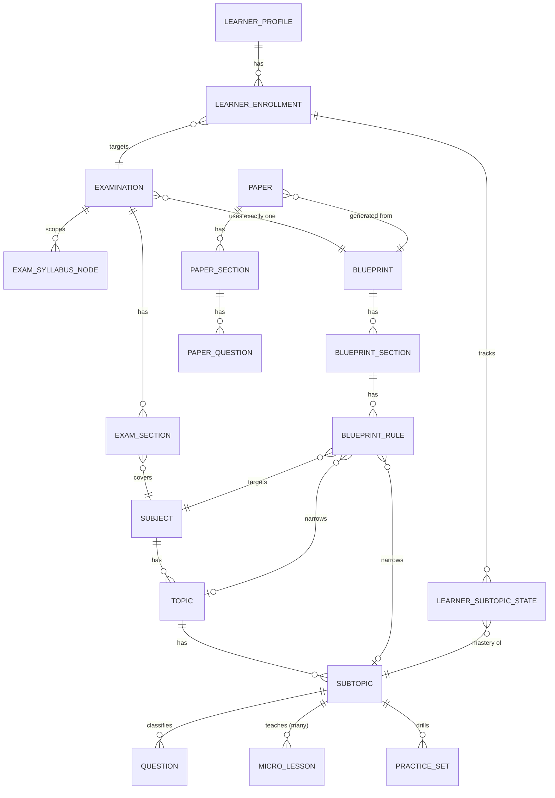
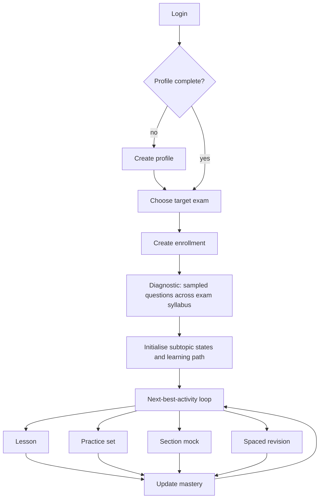

# Unified Exam Spine: Architecture Analysis & Plan

Status: Proposal, updated with owner decisions (section 7). Platform is pre-production, so there is no data migration and no backward compatibility. Existing migrations and seed data are rewritten in place.

Spine: **Examination → Subject → Topic → SubTopic → Question**. Taxonomy and questions are shared across exams through **Blueprints**. Micro/Macro learning hangs off the same spine.

**Product focus (current target):** exam-adaptive learning. After login the student creates a profile, picks a target exam, and the adaptive engine starts the learning flow (section 2.7). Everything else (admin authoring, delivery of mock exams) serves that flow.

---

## 1. Current State and Defects

| Area | Today | Problem |
|---|---|---|
| Examination | `examination.sections_json` (JSONB). `Section.subject` and `SubjectTopicRule.topic` are free strings. | No link to taxonomy. No subtopic. Sections are not entities. |
| Taxonomy | `question_service.subject/topic/subtopic` (BIGINT ids), owned by question-bank only. | Seeds create divergent copies per exam (Mathematics vs Quantitative Aptitude, Reasoning vs General Intelligence, General Awareness vs General Studies). |
| Question | Partitioned by `subject_id`. Holds both FK ids and denormalized strings. `used_in_exam_ids_json`. | Strings are used for matching, and there is no exam link. |
| Blueprint | `blueprint_template.rules_json` with string `subject` and `topic`. `exam_id` is optional. | No ids and no subtopic. Matching uses `UPPER(TRIM(subject)) = ...`. |
| Paper | `paper_definition_json` is a flat `questionIds` list. | Sections are lost, so section-wise scoring is impossible. |
| Micro-lessons | Unique on `(subtopic_id, target_exam)`. `target_exam` is a free string. | Duplicated per exam, and only one lesson per subtopic and exam. |
| Recommendation / Practice | `UNIQUE(candidate_id, subtopic_name)`. `practice_set.subject_slug`. `exam_target` is a string. | Name-keyed, so it is fragile. |
| Learner journey | Candidate has no profile or enrolment concept tied to an exam. | The learning flow can't start from "my target exam". |
| Frontend | Taxonomy lives in the Question Bank menu. The blueprint rule builder uses strings. The exam form has manual section text fields. | Three separate mental models. |

## 2. Target Architecture

### 2.1 Core principles
1. **Platform-default taxonomy with tenant overrides**: one canonical `Mathematics`, one `Reasoning`. A tenant inherits the platform default and may add, hide or rename nodes (section 2.4). No exam owns a taxonomy node.
2. **Questions belong to exactly one SubTopic (mandatory).** They are never copied per exam. Exam usage is derived through blueprints.
3. **One blueprint per exam.** The blueprint is the sharing contract: it selects taxonomy nodes and quotas. Blueprints are independent entities, so several exams can reuse the same blueprint. Each exam points to exactly one. Shifts and stages are separate `examination`/paper concerns, not extra blueprints.
4. **Exam syllabus is explicit and relational.** An exam declares which subjects, topics and subtopics are in scope (`exam_syllabus_node`). It is not a string blob.
5. **IDs, not names, everywhere.** Names are display only and are resolved from a taxonomy cache or lookup.
6. **Learning content is keyed by SubTopic and is exam-agnostic.** A subtopic has multiple lessons. The learner's target exam only decides which subtopics are in scope and how they are weighted.
7. **Logical FKs across service schemas.** Micro mode keeps independent databases. Macro/monolith mode may add real FKs where schemas co-locate. Validation goes through a `TaxonomyClient`.

### 2.2 Ownership
Create a **taxonomy bounded context** in `question-bank-service`. It is the source of truth for Subject/Topic/SubTopic and is exposed via REST, gRPC and a Kafka/Rabbit event. Extracting it into its own service later is possible but not needed now.

### 2.3 Domain model

### 2.4 Schema (rewrite baseline migrations)

**question_service (taxonomy + questions)**
- `subject(id, tenant_id NULL, code, name, active)`, `topic(id, subject_id, code, name)`, `subtopic(id, topic_id, code, name)`.
  - **Platform default + tenant override:** `tenant_id IS NULL` marks a platform node. A tenant node has its tenant id, and an optional `base_node_id` points to the platform node it overrides or extends.
  - Add `taxonomy_tenant_override(tenant_id, node_type, node_id, hidden BOOL, name_override, order_override)` so a tenant can hide or rename a platform node without copying it. Tenants can also add their own nodes under a platform or tenant parent.
  - The effective tree for a tenant = platform nodes + overrides + tenant nodes. `TaxonomyClient` returns the effective tree. Ids of platform nodes stay stable, so platform questions, lessons and blueprints keep working for every tenant.
  - Add stable `code` (slug), unique per parent per scope, so seeds and APIs can reference nodes without relying on names. Add `display_order` and `description`.
- `question`: keep `subject_id`, `topic_id`, and make `subtopic_id` **NOT NULL**. Drop the string columns `subject/topic/subtopic` and `used_in_exam_ids_json`. Keep `chapter` only if it has a distinct meaning.
  - Add a trigger or service-level validation that `subtopic → topic → subject` is consistent.
- `subtopic_micro_lesson`: **many lessons per subtopic**. Drop `target_exam`, the string columns and the `(subtopic_id, target_exam, content_version)` uniqueness. New shape:
  - `id, subtopic_id, tenant_id NULL, lesson_type {CONCEPT|WORKED_EXAMPLES|TRAPS_AND_PITFALLS|CHEAT_SHEET|VIDEO|VISUAL|STORY_ANALOGY|QUICK_RECAP}, difficulty_level {FOUNDATION|CORE|ADVANCED}, sequence_no, estimated_minutes, language, content (core_concept, trap, cheat_sheet, steps JSONB), status, quality_score, content_version`.
  - `UNIQUE(subtopic_id, lesson_type, difficulty_level, sequence_no, content_version)`.
  - Optional `prerequisite_lesson_id`, so lessons within a subtopic form a path.
  - `lesson_effectiveness(lesson_id, views, completions, post_lesson_accuracy_delta)` is aggregated from learner outcomes and used to rank lessons.
  - Translations stay in `microlesson_translation`.

**examination_service**
- `examination(id, code, name, status, duration_minutes, total_marks, **blueprint_id NOT NULL**, ...)`.
- `examination_section(id, examination_id, subject_id, name, order_index, question_count, marks_per_question, negative_marks, duration_minutes NULL)`.
- `exam_syllabus_node(id, examination_id, node_type {SUBJECT|TOPIC|SUBTOPIC}, node_id, weightage_pct NULL)`. It defines the in-scope syllabus and drives the learning scope.

**paper_generator**
- `blueprint(id, code, name, version, status, tenant_id NULL)`. Blueprints are **independent of exams** and reusable. `tenant_id NULL` means a platform blueprint.
- `blueprint_section(id, blueprint_id, name, order_index, subject_id)`.
- `blueprint_rule(id, blueprint_section_id, subject_id NOT NULL, topic_id NULL, subtopic_id NULL, difficulty, cognitive_level, question_count, marks_override NULL)`. A rule's granularity is the narrowest non-null id.
- `paper(id, examination_id, blueprint_id, blueprint_version, shift_id, status, ...)`.
- `paper_section(id, paper_id, blueprint_section_id, examination_section_id, name, order_index)`.
- `paper_question(paper_section_id, question_id, position, subtopic_id)`. This replaces the flat JSON list, and `subtopic_id` is a snapshot for analytics.

**delivery / evaluation / result**
- Payloads carry `sectionId`, `subjectId`, `topicId`, `subtopicId`, plus resolved names for display only.
- Score breakdowns are keyed by section and by `subjectId/topicId/subtopicId`. They feed the learner state below.

**identity / candidate (learner profile and enrolment)**
- `learner_profile(candidate_id PK, display_name, education_level, preferred_language, daily_study_minutes, preferred_lesson_types[], prior_experience, created_at, completed_at NULL)`. The profile must be completed before enrolment.
- `learner_enrollment(id, candidate_id, examination_id, target_date NULL, status {ACTIVE|PAUSED|COMPLETED}, started_at)`. A learner has one ACTIVE primary enrolment now and may switch later. Exam change creates a new enrolment and keeps the old state.
- `learner_enrollment` is the only place the "target exam" lives, so every downstream service takes `enrollmentId`/`examId` from it.

**recommendation / practice (adaptive engine)**
- `learner_subtopic_state(enrollment_id, subtopic_id, mastery_score, confidence, attempts, correct, last_practiced_at, next_review_at, status {NOT_STARTED|LEARNING|PRACTISING|MASTERED|REVIEW_DUE}, preferred_lesson_type NULL)`, `UNIQUE(enrollment_id, subtopic_id)`. It replaces `learner_subtopic_performance(candidate_id, subtopic_name)`.
- `learner_lesson_progress(enrollment_id, lesson_id, status, completed_at, helpful_rating NULL)`. It records which lessons the learner has seen, so the engine picks the next unseen lesson.
- `dynamic_learning_path(enrollment_id, ...)` replaces `exam_target`. Path items reference `subtopic_id` and an activity `{LESSON, PRACTICE, MOCK_SECTION, REVISION}`.
- `practice_set`: `subject_id/topic_id/subtopic_id` replace `subject_slug`. Questions are resolved by taxonomy, not from a stored id list, unless the set is curated.

### 2.5 Validation invariants (enforced in services)
1. A blueprint rule's topic belongs to its subject, and its subtopic belongs to its topic.
2. A blueprint section's subject equals the rule subjects within it.
3. An exam's blueprint rules must lie inside the exam's `exam_syllabus_node` set. Publishing an exam is blocked otherwise.
4. Publishing an exam requires a sufficiency check to pass: for each rule, available questions ≥ required × shift count × buffer (reuse `blueprint_sufficiency_analysis_report.md`, now at subtopic granularity).
5. A paper's section question counts equal the exam section's `question_count`.
6. Every syllabus subtopic of a **published** exam has at least one question and at least one lesson. This makes the learning flow completable.
7. A taxonomy node in use can't be hard-deleted. Platform nodes can be hidden per tenant but not removed by a tenant. Merging nodes is an admin operation that rewrites the references.
8. A learner can't create an enrolment before the profile is complete, and only for a published exam.

### 2.6 Micro / Macro deployment compatibility
- **Microservices**: `TaxonomyClient` (gRPC with a REST fallback, cached with event-driven invalidation on `TaxonomyChanged`). There are no cross-schema FKs.
- **Macro (content-app / monolith)**: the same `TaxonomyClient` interface is bound to an in-process bean with direct repository access. A `@Profile` or conditional bean selects the implementation.
- Add the shared contract in `shared-lib`: `TaxonomyNodeRef(subjectId, topicId, subtopicId)`, `TaxonomyClient`, `TaxonomyChanged` events, and `EnrollmentRef(candidateId, enrollmentId, examId)`.
- Keep one proto definition. `BlueprintMatchGrpcRequest` changes to numeric ids (`subject_id`, `topic_id`, `subtopic_id`).
- Both modes share the same Flyway scripts per schema.

### 2.7 Learner journey and adaptive engine

1. **Profile** (once): language, education level, daily study time, preferred lesson styles, optional target date. The candidate app routes to onboarding until `learner_profile.completed_at` is set.
2. **Target exam**: the learner selects a published exam from the catalogue. This creates the `learner_enrollment` and scopes everything to `exam_syllabus_node`.
3. **Diagnostic**: a short adaptive test drawn from the exam's blueprint rules, with at least one question per syllabus subject and more where blueprint weight is high. Results seed `learner_subtopic_state.mastery_score`. The learner can skip it, in which case mastery starts at a neutral prior.
4. **Path initialisation**: order the syllabus subtopics by `blueprint weight × (1 − mastery)` and by taxonomy order and prerequisites.
5. **Next-best-activity loop** (the engine core):
   - Pick the subtopic with the highest priority: low mastery, high blueprint weight, review due.
   - Pick the activity. Low mastery and no lesson seen → **lesson**. A lesson seen → **practice**. Repeated failure → **a different lesson** of another `lesson_type` or level. High mastery → **spaced revision** or **section mock**.
   - **Lesson selection** among the many lessons of a subtopic: filter by learner preferences, skip completed lessons, and rank by difficulty fit and `lesson_effectiveness`. The aim is variety, so if the learner fails practice after lesson A, the engine serves lesson B in another style.
   - **Practice selection** uses `AdaptiveQuizGenerator` over `subtopic_id` with difficulty matched to mastery, and avoids recently seen questions.
6. **Mastery update**: after each activity, update `mastery_score` and `confidence` (an Elo-like or Bayesian knowledge tracing model is acceptable, to be chosen in Phase 6). Schedule `next_review_at` with spaced repetition.
7. **Readiness**: exam readiness = Σ blueprint weight × mastery. It is shown on the dashboard, and when it passes a threshold the engine suggests full mocks generated from the exam's single blueprint.
8. **Events**: `EnrollmentCreated`, `DiagnosticCompleted`, `LessonCompleted`, `PracticeSubmitted`, `MockResultPublished`. The recommendation service consumes them. In macro mode they use the existing in-process publisher.

## 3. API Changes

| Endpoint | Change |
|---|---|
| `GET /api/v1/taxonomy/tree` | Replaces `/subjects/hierarchy`. Returns the **effective tree** for the caller's tenant. Supports `?examId=` to return only the exam's syllabus subtree. |
| `/api/v1/subjects`, `/topics`, `/subtopics` CRUD | Keep. Add `code`, merge and reorder. Tenant admins write tenant nodes and overrides, and only platform admins write platform nodes. |
| `PUT /api/v1/taxonomy/overrides` | Hide, rename or reorder a platform node for a tenant. |
| `GET /api/v1/examinations/{id}/syllabus` | Returns the tree scoped to the exam. `PUT` replaces the syllabus nodes. |
| `/api/v1/examinations` | Create and update take `sections[{subjectId,...}]` and a single `blueprintId`. |
| `/api/v1/papers/blueprints` (renamed from `blueprint-templates`) | Rules use ids. Sections are first-class. `check-sufficiency` takes `{blueprintId, examId?, shifts}`. |
| `POST /api/v1/questions/match-blueprint` and gRPC | Numeric ids only. |
| `GET /api/v1/questions` | Filters are `subjectId/topicId/subtopicId`. |
| `GET /api/micro-lessons/subtopic/{id}` | Returns a list of lessons. Filters: `lessonType`, `difficulty`, `language`. No exam parameter. |
| `GET /api/v1/learner/profile`, `PUT /api/v1/learner/profile` | Profile onboarding. |
| `GET /api/v1/learner/exams` | Catalogue of published exams the learner can target. |
| `POST /api/v1/learner/enrollments` | `{examinationId, targetDate?}`. Requires a completed profile. Starts the diagnostic. |
| `POST /api/v1/learner/enrollments/{id}/diagnostic` and `/submit` | Diagnostic session and results. |
| `GET /api/v1/learning/enrollments/{id}/next-activity` | Next-best activity `{type, subtopicId, lessonId?, practiceSetId?}`. |
| `POST /api/v1/learning/enrollments/{id}/activities/{aid}/complete` | Reports the outcome and updates the mastery. |
| `GET /api/v1/learning/enrollments/{id}/progress` | Syllabus tree with mastery, readiness and due revisions. |

## 4. Frontend Plan (`nag-frontend-workspace`)

1. **Shared taxonomy lib**: new `libs/shared/taxonomy` with a `TaxonomyStore` (signals) that caches the effective tree and offers `nodeName(id)`. All screens use it instead of strings.
2. **Cascading selector**: replace `taxonomy-selector` and the AI prompt config selectors with a single `taxonomy-picker`. It runs Subject → Topic → SubTopic, and subtopic is mandatory for questions.
3. **Admin portal navigation**: group under **Curriculum**: Taxonomy (with a platform vs tenant view and overrides), Blueprints, Examinations (syllabus + sections + blueprint). The Question Bank menu keeps Questions, Authoring, AI Generate and Translations. Micro-lesson authoring supports several lessons per subtopic with type and level. Preserve `<router-outlet>` and all sibling menus in `app.html`.
4. **Exam form**: sections are chosen from subjects, and the syllabus is a tree with checkboxes. One blueprint is selected, with a live sufficiency and content-coverage badge (questions and lessons per subtopic). Remove the free-text subject/topic fields.
5. **Blueprint builder**: section → rule rows with id-based pickers and a coverage heat-map (needed vs available per node).
6. **Candidate app (priority)**:
   - Route guard chain: auth → profile complete → active enrolment → dashboard.
   - `onboarding-profile` component, then `exam-picker` (exam catalogue with syllabus preview), then `diagnostic` runner.
   - **Learning home**: readiness meter, today's next-best-activity card, syllabus tree with mastery heat-map, and due revisions.
   - **Lesson player** with multiple lessons per subtopic: a lesson-type switcher, "try another explanation" and a helpful/not-helpful rating.
   - Practice and mock screens are scoped to the enrolled exam. Results show a Section → Topic → SubTopic drill-down.
   - Allow switching the target exam from the profile page.
7. Follow `AGENTS.md`: standalone, OnPush, signals, a kebab-case sub-component directory for each piece, with `.ts/.html/.scss` split.

## 5. Phased Execution Plan

Because adaptive learning is the priority, the learner path is built end to end early (Phases 0–4 and 6) and exam delivery details (Phase 5) follow.

| Phase | Scope | Exit criteria |
|---|---|---|
| 0. Contracts | `shared-lib`: `TaxonomyClient`, `TaxonomyNodeRef`, `EnrollmentRef`, events, proto changes. ADR "Unified Exam Spine". | The protos compile and the ADR is merged. |
| 1. Taxonomy | Rewrite baseline taxonomy migration (codes, order, `tenant_id NULL` platform scope, overrides). Consolidate seeds into one platform taxonomy. Add the effective-tree, override, merge and reorder APIs. | One platform taxonomy with no duplicate subjects. A tenant override test passes. |
| 2. Questions | Make `subtopic_id` NOT NULL, drop the string columns and exam-id JSON. Update the repositories, the AI generator, bulk import (`question_1.csv`) and the seeds to resolve codes to ids. | Question CRUD, import and AI generation work with ids. |
| 3. Examination and blueprint | `examination_section`, `exam_syllabus_node`, `examination.blueprint_id`, relational blueprint sections and rules, drop `sections_json`. Publish validation including invariant 6. | The exam and blueprint APIs round-trip relationally. |
| 4. Learner onboarding | `learner_profile`, `learner_enrollment`, exam catalogue, enrolment APIs, diagnostic session. Frontend onboarding, exam picker and guards. | A new user can log in, create a profile, pick an exam and finish a diagnostic. |
| 5. Micro-lessons v2 | Multi-lesson-per-subtopic schema, authoring and AI generation by `lesson_type` and level, progress and effectiveness tables, lesson API. | A subtopic holds at least 3 lesson variants and the player can switch between them. |
| 6. Adaptive engine | `learner_subtopic_state`, path initialisation, next-best-activity, mastery update, spaced repetition, readiness. Rewrite `recommendation-service` and `practice-service` over ids. | A scripted learner converges: mastery rises and the activity mix changes as designed. |
| 7. Paper and delivery | Structured `paper_section/paper_question`, updated `PaperAssemblyService`, section-aware delivery, evaluation and result keyed by ids. Mock results feed the engine. | An end-to-end mock run shows a section and topic breakdown and updates mastery. |
| 8. Frontend completion | Admin items 1–5 and candidate learning home, lesson player and progress screens. | `npx nx run-many -t build --skip-nx-cache` passes. |
| 9. Verification | Unit and integration tests, contract tests in micro and macro modes, e2e learner journey. Docker builds with `--no-cache` (backend monolith plus the frontend images). | All green in both deployment modes. |

Phases 2, 3 and 5 can run in parallel once Phases 0 and 1 are done. Phase 4 can start in parallel with them. Phase 6 needs Phases 2, 4 and 5. The frontend can start against stubs after Phase 0.

## 6. Risks and Decisions

| # | Topic | Recommendation |
|---|---|---|
| 1 | Question partitioning by `subject_id` | Subjects are now canonical and few, so skew is a concern: consider partitioning by `tenant_id` or hashing on `id` instead. Decide in Phase 2. |
| 2 | Same concept at different depth in different exams | Handle it with the blueprint rule granularity (subject, topic or subtopic) rather than separate nodes. |
| 3 | Exam-specific difficulty or flavour of a question | Use difficulty and tags. Do not duplicate questions. Exam fit comes only from the blueprint and syllabus. |
| 4 | Tenant overrides and shared content | Platform questions and lessons are visible to all tenants unless the tenant hides the node. Tenant content lives under `tenant_id`. |
| 5 | Taxonomy merge or rename after use | Ids are stable and codes are immutable. Merge is an explicit transactional rewrite plus an event. |
| 6 | Papers already generated | A paper snapshots `blueprint_version` and `subtopic_id`, so later taxonomy edits don't change history. |
| 7 | Cache staleness in micro mode | Event-driven invalidation plus a short TTL. |
| 8 | Content volume | Several lessons per subtopic multiplies authoring. Use AI generation by `lesson_type` and level with a review queue. Publish gate: at least one lesson and one question per syllabus subtopic, with a target of 3+ lessons. |
| 9 | Cold start for the engine | The diagnostic and neutral priors cover it. Mastery model choice is deferred to Phase 6. |
| 10 | One blueprint per exam vs multi-stage exams (Prelims/Mains) | Model each stage as its own `examination` (own blueprint) and link stages with an optional `parent_examination_id` for the learner's enrolment. |

## 7. Decisions Taken (from owner)

| Question | Decision |
|---|---|
| Taxonomy scope | Platform-wide default, with tenant-level modifications (overrides and tenant-added nodes). |
| Subtopic on a question | Mandatory. |
| Blueprints per exam | Exactly one blueprint per exam. |
| Micro-lessons | Exam-agnostic, **multiple lessons per subtopic** for more effective learning. |
| Product focus | Exam-adaptive learning: login → profile → choose target exam → engine starts the learning flow. |

Open points left for later: the mastery model (Phase 6), whether tenants may override platform blueprints (the plan assumes they copy and edit them), and how multi-stage exams appear to learners (risk 10).

## 8. Analysis Sources
- Backend audit covered `examination-service`, `question-bank-service`, `paper-generator`, `delivery-service`, `practice-service`, `recommendation-service`, `shared-lib`, `content-app` and the micro/macro deployment docs.
- Frontend audit covered `apps/admin-portal`, `apps/candidate-delivery` and `libs/{questions,examinations}`. There is no React app in the repo. `candidate-frontend` in `AGENTS.md` is stale.
- Related: `docs/blueprint_sufficiency_analysis_report.md`, `docs/micro-marco/implementation_plan.md`, `docs/adr/0007-tri-mode-deployment-architecture.md`.
