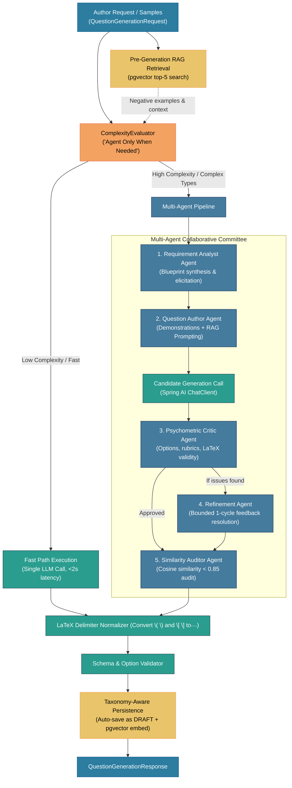
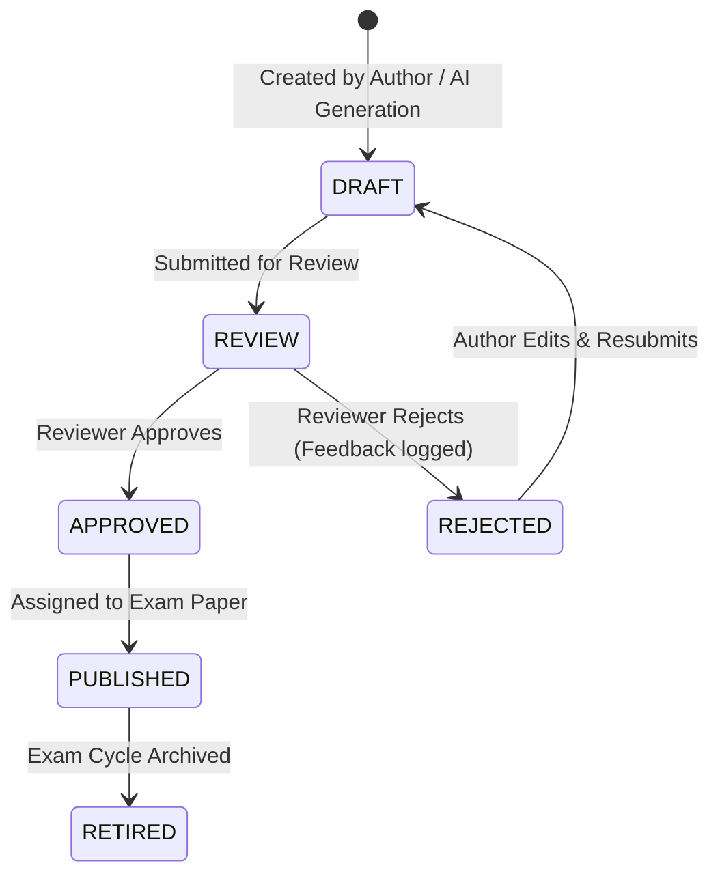

# Module Specification: Question Bank Service

## 1. Overview & Purpose

The **Question Bank Service** is a core bounded context within the National Assessment Grid (NAG). It provides end-to-end question item authoring, hierarchical taxonomy classification, multi-stage peer review and approval workflows, envelope encryption, automated duplicate detection via pgvector embeddings, and an **AI-Assisted Question Generation Engine** orchestrated by [`SpringAiGenerationService`](file:///F:/code/IdeaProjects/nag/backend/question-bank-service/src/main/java/com/examplatform/questionbank/ai/generation/SpringAiGenerationService.java).

The service supports diverse question types:
- Single-Choice Objective Questions (`SINGLE_MCQ`)
- Multiple-Choice Objective Questions (`MULTI_MCQ`)
- Numerical Response Questions (`NUMERICAL`)
- Descriptive / Subjective Questions (`DESCRIPTIVE`)
- Assertion-Reasoning (`ASSERTION_REASON`)
- Paragraph-Set Reading Comprehension (`PARAGRAPH_SET`)
- Matrix Matching (`MATRIX_MATCH`)

---

## 2. Core Responsibilities

- **Manual & AI-Powered Item Authoring**: Direct authoring with rich text, SVG figures, KaTeX/LaTeX math notations (`$$...$$`), and chemical equations (`\ce{...}`).
- **Intelligent Dual-Path AI Generation Pipeline**: Conditional triage between sub-2-second Single-Model Fast Path and a 5-agent Multi-Agent Collaborative Committee.
- **Tiered Multimodal Document Parsing**: Cost-optimized ingestion of syllabus PDFs and sample question images (Tier 0 local text extraction, Tier 1 selective raster diagram isolation, Tier 2 scanned OCR fallback).
- **Vector Search & RAG Deduplication**: Cosine similarity checks using pgvector and 768-dimensional embeddings to avoid near-duplicate question generation (<0.85 similarity threshold).
- **Strict Taxonomy Management**: Subject $\rightarrow$ Topic $\rightarrow$ Subtopic hierarchical classification with ID-based resolution to prevent phantom taxonomy generation.
- **Multi-Stage Review Workflow**: State machine transitions (`DRAFT` $\rightarrow$ `REVIEW` $\rightarrow$ `APPROVED` / `REJECTED` $\rightarrow$ `PUBLISHED` $\rightarrow$ `RETIRED`).
- **Cryptographic Security**: Envelope encryption for question stem and answer keys using per-tenant encryption keys from KMS/Vault.
- **Asynchronous Batch Inference**: High-volume question generation jobs processed via AWS Bedrock Batch Inference and LiteLLM gateway.

---

## 3. AI Question Generation Subsystem (`SpringAiGenerationService`)

The AI question generation subsystem is implemented in [`SpringAiGenerationService`](file:///F:/code/IdeaProjects/nag/backend/question-bank-service/src/main/java/com/examplatform/questionbank/ai/generation/SpringAiGenerationService.java), which coordinates model routing, sample question parsing, RAG vector retrieval, complexity triage, multi-agent evaluation, delimiter normalization, and persistence.

### 3.1 Architecture & Workflow Diagram



---

### 3.2 "Agent Only When Needed" Complexity Triage (`ComplexityEvaluator`)

Rather than invoking an expensive multi-agent committee for all requests, [`ComplexityEvaluator`](file:///F:/code/IdeaProjects/nag/backend/question-bank-service/src/main/java/com/examplatform/questionbank/ai/generation/multiagent/ComplexityEvaluator.java) dynamically evaluates incoming parameters to decide between:
1. **Single-Model Fast Path**: Used for ~90% of requests (direct recall, standard single-step MCQs, low cognitive demand). Provides sub-2-second response latency and minimal token consumption.
2. **Multi-Agent Committee**: Escalates only when at least one complexity trigger is present:
   - **Explicit User Override**: `request.getExecutionMode() == ExecutionMode.MULTI_AGENT`.
   - **Explicit Quality Flags**: `requireCriticReview == true` or `generationQuality == "EXAM_READY"`.
   - **High Cognitive Levels**: Bloom's taxonomy levels `ANALYZE`, `EVALUATE`, or `CREATE`.
   - **Complex Question Types**: `PARAGRAPH_SET`, `ASSERTION_REASON`, `MATRIX_MATCH`, or `NUMERICAL` at `HARD` difficulty.
   - **High-Stakes Examination Benchmarks**: Target exam codes matching `JEE_ADV`, `UPSC_CSE`, or `GATE`.
   - **Multimodal Sample Characteristics**: When math, chemical formulas (`\ce{...}`), or embedded diagrams are detected in uploaded samples.

If the user explicitly sets `executionMode = FAST` and `requireCriticReview = false`, the evaluator respects the fast-path override.

---

### 3.3 Multi-Agent Collaborative Committee Breakdown

When escalated, [`SpringAiGenerationService`](file:///F:/code/IdeaProjects/nag/backend/question-bank-service/src/main/java/com/examplatform/questionbank/ai/generation/SpringAiGenerationService.java) executes a synchronized 5-agent committee workflow:

| Agent | Class | Core Responsibility |
|---|---|---|
| **1. Requirement Analyst** | [`RequirementAnalystAgent`](file:///F:/code/IdeaProjects/nag/backend/question-bank-service/src/main/java/com/examplatform/questionbank/ai/generation/multiagent/RequirementAnalystAgent.java) | Synthesizes a structured generation blueprint from syllabus taxonomy, author prompt, and sample questions. Also drives conversational clarification (`clarifyRequirements`) for ambiguous prompts. |
| **2. Question Author** | [`QuestionAuthorAgent`](file:///F:/code/IdeaProjects/nag/backend/question-bank-service/src/main/java/com/examplatform/questionbank/ai/generation/multiagent/QuestionAuthorAgent.java) | Compiles few-shot demonstrations from sample inputs, incorporates retrieved RAG negative examples, and formats the LLM generation prompt. |
| **3. Psychometric Critic** | [`PsychometricCriticAgent`](file:///F:/code/IdeaProjects/nag/backend/question-bank-service/src/main/java/com/examplatform/questionbank/ai/generation/multiagent/PsychometricCriticAgent.java) | Evaluates candidate items against psychometric standards: unambiguous single correct key, non-trivial distractors (no throwaway answers like "None of the above"), KaTeX/mhchem validity, and Bloom's alignment. |
| **4. Refinement Agent** | [`RefinementAgent`](file:///F:/code/IdeaProjects/nag/backend/question-bank-service/src/main/java/com/examplatform/questionbank/ai/generation/multiagent/RefinementAgent.java) | Resolves issues raised by the critic (replacing weak distractors, repairing broken formulas, improving explanations). Strictly bounded to 1 retry cycle to avoid unbounded latency/cost. |
| **5. Similarity Auditor** | [`SimilarityAuditorAgent`](file:///F:/code/IdeaProjects/nag/backend/question-bank-service/src/main/java/com/examplatform/questionbank/ai/generation/multiagent/SimilarityAuditorAgent.java) | Executes pgvector cosine similarity lookup against existing questions in the tenant question bank; enforces strict uniqueness threshold ($< 0.85$). |

---

### 3.4 Tiered Multimodal Document Parser Ladder (`SampleDocumentParserService`)

Authors can supply syllabus material or past exam papers (PDF, PNG, JPEG, WEBP) to condition generation. To avoid excessive cloud vision token expenses, [`SampleDocumentParserService`](file:///F:/code/IdeaProjects/nag/backend/question-bank-service/src/main/java/com/examplatform/questionbank/ai/parser/SampleDocumentParserService.java) processes documents through a 3-tier extraction ladder:

```
[ Uploaded Document / File ]
             │
             ▼
┌────────────────────────────────────────────────────────────────────────┐
│ Tier 0: Local Text Extraction (Apache PDFBox)                          │
│ - Extracts digital text streams locally.                               │
│ - If digital text exists and no diagrams are present:                  │
│   Completely bypasses vision models → $0.00 vision token spend.        │
└───────────────────────────────────┬────────────────────────────────────┘
                                    │ (diagram detected or text missing)
                                    ▼
┌────────────────────────────────────────────────────────────────────────┐
│ Tier 1: Selective Image Extraction (PDImageXObject)                    │
│ - Extracts raster images directly from PDF object streams.             │
│ - Downsamples only the isolated diagram (max 1024px dimension)         │
│   rather than rasterizing full high-DPI document pages.                │
└───────────────────────────────────┬────────────────────────────────────┘
                                    │ (scanned PDF / zero text stream)
                                    ▼
┌────────────────────────────────────────────────────────────────────────┐
│ Tier 2: Scanned Document Rasterization                                 │
│ - Renders scanned pages at 150 DPI (SCANNED_RENDER_DPI).                │
│ - Saves 75% memory/token footprint compared to standard 300 DPI scans. │
└────────────────────────────────────────────────────────────────────────┘
```

---

### 3.5 Pre-Generation Vector Search & RAG Deduplication

Before generating questions, [`SpringAiGenerationService.retrieveRagContext()`](file:///F:/code/IdeaProjects/nag/backend/question-bank-service/src/main/java/com/examplatform/questionbank/ai/generation/SpringAiGenerationService.java) executes:
1. Builds a composite search query from `subject`, `topic`, `subtopic`, and author `rawTextInput` / `description`.
2. Encodes the query into a 768-dimensional embedding via [`EmbeddingService`](file:///F:/code/IdeaProjects/nag/backend/question-bank-service/src/main/java/com/examplatform/questionbank/ai/embedding/EmbeddingService.java) (`nomic-embed-text`).
3. Queries `question_service.question` via pgvector for the top 5 (`RAG_TOP_K = 5`) most similar existing questions in the subject domain.
4. Injects these retrieved questions into the LLM system/user prompt as negative constraints ("Existing questions on this topic for reference — do NOT duplicate them").

---

### 3.6 Mathematical & Chemical Syntax Normalization

To ensure seamless rendering in candidate exam interfaces using KaTeX:
- **Strict Delimiters**: All mathematical and chemical formulas in `content`, `options[].text`, `answerKey`, and `explanation` must use `$$ ... $$` delimiters.
- **Automated Repair**: [`SpringAiGenerationService.normalizeLatex()`](file:///F:/code/IdeaProjects/nag/backend/question-bank-service/src/main/java/com/examplatform/questionbank/ai/generation/SpringAiGenerationService.java) automatically converts forbidden LaTeX delimiters (`\( ... \)` and `\[ ... \]`) emitted by LLMs into compliant `$$ ... $$` blocks via regex replace.
- **mhchem Support**: Chemical equations use `$$\ce{...}$$` (e.g. `$$\ce{2H2 + O2 -> 2H2O}$$`), and physical units use `$$\pu{...}$$`.
- **Percentage Signs**: Percent signs inside math mode are escaped as `\%` (`$$99.9\%$$`).

---

### 3.7 Taxonomy-Aware Persistence & Lifecycle Integration

When `autoSave = true` is requested:
1. **Taxonomy ID Resolution**:
   - If `subjectId` and `topicId` are provided, [`SubjectTopicService.resolveByIds()`](file:///F:/code/IdeaProjects/nag/backend/question-bank-service/src/main/java/com/examplatform/questionbank/service/SubjectTopicService.java) validates their existence. It never creates new taxonomy nodes, preventing misspelled subjects from polluting the database.
   - If IDs are omitted, it falls back to name-based resolution (`resolveOrCreateByName`).
2. **Persistence**: Saves the question to `question_service.question` in `DRAFT` state with author ID from JWT.
3. **Embedding Computation**: Immediately generates an embedding vector via `EmbeddingService` and updates `question.embedding_vector` using raw SQL with pgvector cast, making the newly saved question instantly discoverable for duplicate checks.

---

### 3.8 Asynchronous Batch Question Generation (`BedrockBatchService`)

For large question authoring quotas (up to 100 questions across multiple subjects/topics):
- [`BatchGenerationController`](file:///F:/code/IdeaProjects/nag/backend/question-bank-service/src/main/java/com/examplatform/questionbank/controller/BatchGenerationController.java) accepts [`BatchGenerationRequest`](file:///F:/code/IdeaProjects/nag/backend/question-bank-service/src/main/java/com/examplatform/questionbank/ai/batch/BatchGenerationRequest.java).
- [`BedrockBatchService`](file:///F:/code/IdeaProjects/nag/backend/question-bank-service/src/main/java/com/examplatform/questionbank/ai/batch/BedrockBatchService.java) aggregates requests into a single JSONL file, uploads it to S3, and starts an AWS Bedrock Model Invocation Job.
- A scheduled worker polls job status, parses generated outputs, normalizes LaTeX delimiters, and bulk-saves generated items into the question bank as `DRAFT`.

---

## 4. Question Lifecycle State Machine

Questions move through an audited lifecycle managed by `QuestionLifecycleService`:



---

## 5. Data Model

### Question Entity Table (`question_service.question`)

```sql
CREATE TABLE question_service.question (
    id UUID PRIMARY KEY DEFAULT gen_random_uuid(),
    tenant_id VARCHAR(64) NOT NULL,
    subject_id BIGINT NOT NULL,
    topic_id BIGINT NOT NULL,
    subtopic_id BIGINT,
    subject VARCHAR(100) NOT NULL,
    topic VARCHAR(200) NOT NULL,
    subtopic VARCHAR(200),
    chapter VARCHAR(200),
    difficulty VARCHAR(20) NOT NULL DEFAULT 'MEDIUM',
    cognitive_level VARCHAR(30) NOT NULL DEFAULT 'APPLY',
    question_type VARCHAR(30) NOT NULL DEFAULT 'SINGLE_MCQ',
    content TEXT NOT NULL,                  -- AES-256 encrypted question stem with LaTeX/SVG
    answer_key TEXT NOT NULL,               -- AES-256 encrypted answer key or rubric
    explanation TEXT,                       -- Detailed solution derivation with LaTeX
    options JSONB,                          -- JSON array of QuestionOption [id, text, isCorrect, ...]
    source_references TEXT,                 -- Citations / 'AI-generated via nova-lite'
    embedding_vector vector(768),           -- 768-dim nomic-embed-text pgvector for similarity
    has_images BOOLEAN DEFAULT FALSE,       -- Visual flag for image/diagram inclusion
    state VARCHAR(20) NOT NULL DEFAULT 'DRAFT',
    author_id UUID NOT NULL,
    reviewer_id UUID,
    usage_count INTEGER DEFAULT 0,
    created_at TIMESTAMP WITH TIME ZONE DEFAULT CURRENT_TIMESTAMP,
    updated_at TIMESTAMP WITH TIME ZONE DEFAULT CURRENT_TIMESTAMP,
    version BIGINT DEFAULT 1
);

CREATE INDEX idx_question_tenant_subject ON question_service.question(tenant_id, subject_id, state);
CREATE INDEX idx_question_embedding ON question_service.question USING ivfflat (embedding_vector vector_cosine_ops);
```

### Batch Generation Job Table (`question_service.batch_generation_jobs`)

```sql
CREATE TABLE question_service.batch_generation_jobs (
    id UUID PRIMARY KEY DEFAULT gen_random_uuid(),
    tenant_id VARCHAR(64) NOT NULL,
    author_id UUID NOT NULL,
    status VARCHAR(30) NOT NULL DEFAULT 'PENDING',
    model_id VARCHAR(100) NOT NULL,
    total_requested INTEGER NOT NULL,
    total_generated INTEGER DEFAULT 0,
    s3_input_uri VARCHAR(512),
    s3_output_uri VARCHAR(512),
    bedrock_job_arn VARCHAR(512),
    error_message TEXT,
    created_at TIMESTAMP WITH TIME ZONE DEFAULT CURRENT_TIMESTAMP,
    completed_at TIMESTAMP WITH TIME ZONE
);
```

---

## 6. REST API Reference

### 6.1 AI Question Generation Endpoints

Base Path: `/api/v1/questions`

| Method | Path | Roles | Description |
|---|---|---|---|
| `POST` | `/generate` | `QUESTION_AUTHOR`, `SUPER_ADMIN` | Generate questions via AI with JSON parameters (Fast Path or Multi-Agent). |
| `POST` | `/generate/with-samples` | `QUESTION_AUTHOR`, `SUPER_ADMIN` | Generate questions with uploaded sample files (`multipart/form-data`) or sample strings (`application/json`). |
| `POST` | `/generate/clarify` | `QUESTION_AUTHOR`, `SUPER_ADMIN` | Elicit and clarify ambiguous generation prompts with the Requirement Analyst Agent. |
| `POST` | `/embeddings/backfill` | `SUPER_ADMIN` | Backfill pgvector embeddings for questions with missing vectors. |
| `POST` | `/batch` | `QUESTION_AUTHOR`, `SUPER_ADMIN` | Submit an asynchronous batch generation job for AWS Bedrock. |
| `GET` | `/batch/{jobId}` | `QUESTION_AUTHOR`, `SUPER_ADMIN` | Check status and progress of an asynchronous batch generation job. |

### 6.2 Question Lifecycle & Management Endpoints

| Method | Path | Roles | Description |
|---|---|---|---|
| `POST` | `/` | `QUESTION_AUTHOR` | Manually draft a new question item. |
| `GET` | `/` | `QUESTION_AUTHOR`, `REVIEWER`, `APPROVER` | List and search questions with filters (subjectId, state, difficulty, translation). |
| `GET` | `/{id}` | `QUESTION_AUTHOR`, `REVIEWER`, `APPROVER` | Retrieve question details by ID. |
| `PUT` | `/{id}` | `QUESTION_AUTHOR` | Update question content, options, and explanation. |
| `PUT` | `/{id}/transition` | `QUESTION_AUTHOR`, `REVIEWER`, `APPROVER` | Trigger lifecycle transition (`DRAFT` $\rightarrow$ `REVIEW` $\rightarrow$ `APPROVED`). |
| `GET` | `/{id}/versions` | `QUESTION_AUTHOR`, `REVIEWER` | View append-only version history and diffs. |
| `GET` | `/subjects` | `QUESTION_AUTHOR`, `EXAM_CONTROLLER` | List active subjects, topics, and subtopics. |
